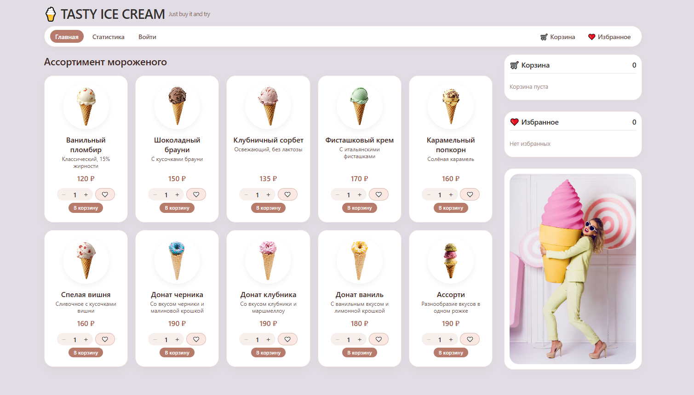
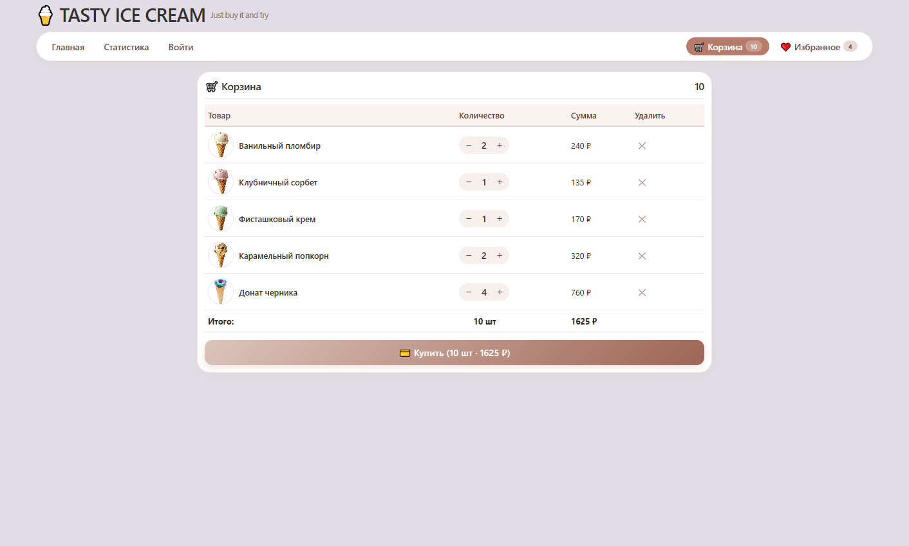
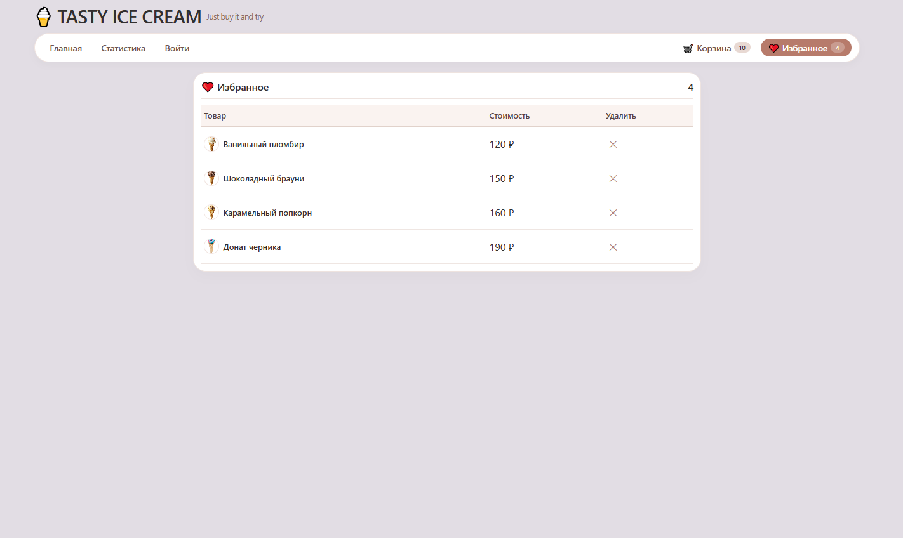
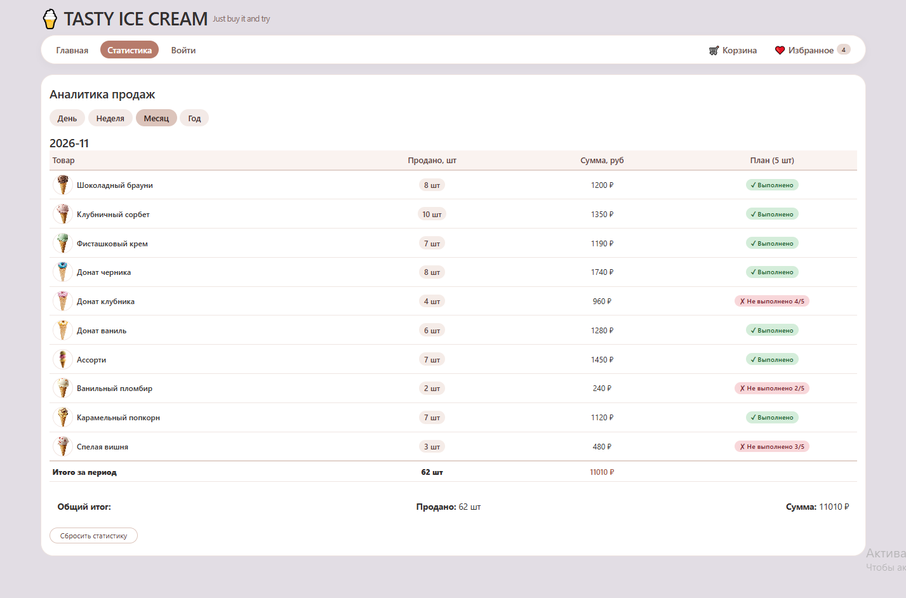
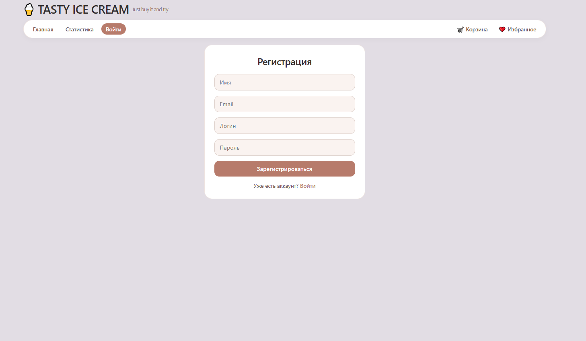

import

<div align="center">
  <h1>🍦 TASTY ICE CREAM — Just buy it and try</h1>
  <p>Интернет-магазин мороженого с корзиной, избранным и аналитикой продаж</p>
</div>

<p align="center">
  
  &nbsp;&nbsp;
  
  &nbsp;&nbsp;
  
  &nbsp;&nbsp;
  
</p>

<p align="center">
  <sub>React 19 · Redux Toolkit · Vite 8 · React Router v7</sub>
</p>

## 📝 О проекте

**TASTY ICE CREAM** — одностраничное приложение (SPA) интернет-магазина мороженого. <br>
Пользователь может просматривать каталог, изменять количество товара, добавлять его в корзину и избранное, оформлять покупку, а также смотреть аналитику продаж за день, неделю, месяц и год.

Проект демонстрирует современный стек фронтенд-разработки: React 19, Redux Toolkit, React Router v6 и Vite. Все данные (пользователи и история покупок) сохраняются в `localStorage`, поэтому приложение работает **без бэкенда**.

## 🖼️ Скриншоты

### Главная страница



### Корзина



### Избранное



### Статистика продаж



### Регистрация и вход



## ✨ Возможности

### 🛒 Каталог и корзина

- Просмотр каталога мороженого с картинками, описанием и ценой
- Изменение количества к покупке кнопками `+` / `−` прямо в карточке
- Добавление товара в корзину
- Изменение количества товара **внутри корзины**
- Удаление товара из корзины (с автоматическим сбросом количества до 1)
- Очистка корзины после оформления покупки
- Счётчик товаров в корзине отображается в навигации

### ❤️ Избранное

- Добавление и удаление товаров из избранного
- Отдельная страница `/favorites` со списком избранного
- Счётчик избранных товаров в навигации

### 💳 Оформление покупки

- Кнопка **«Купить»** в корзине
- Покупка сохраняется в `localStorage` (ключ `icecream_purchases`)
- Уведомление об успешной покупке
- Автоматическая очистка корзины после покупки

### 📊 Аналитика продаж

- Вкладки: **День / Неделя / Месяц / Год**
- Таблица с колонками: **Товар**, **Продано**, **Сумма**, **План**
- План по каждой позиции: **5 штук** за период (настраивается в `src/utils/purchases.js` → `PLAN_PER_PRODUCT`)
- Визуальная индикация выполнения плана: ✅ «Выполнено» / ❌ «Не выполнено 3/5»
- Общий итог по всем периодам
- Сброс статистики

### 👤 Авторизация

- Регистрация: имя, email, логин, пароль
- Вход по логину и паролю
- Валидация: уникальность логина и email, обязательные поля
- Профиль пользователя с возможностью выхода
- Данные пользователей в `localStorage` (ключи `icecream_users`, `icecream_current_user`).

### 📱 Адаптивность

- Полностью адаптивная вёрстка
- Оптимизация под экраны **320px** (мобильные)
- Гибридная сетка: карточки товаров перестраиваются под ширину экрана

## 🛠️ Технологии

- **React 19** — UI, компонентный
- **Redux Toolkit** — управление состоянием (корзина, избранное, товары)
- **React Router v7** — клиентская маршрутизация (SPA)
- **Vite** — сборка, dev-сервер, HMR
- **LocalStorage** - персистентность данных (без бэкенда)

## Структура проекта

```
vite-project /
├── index.html
├── package.json
├── vite.config.js
├── .gitignore
├── README.md
├── screenshots/
│   ├── main.png
│   ├── cart.png
│   ├── favorites.png
│   ├── stats.png
│   └── auth.png
└── src/
    ├── main.jsx                # Точка входа, Provider, StrictMode
    ├── App.jsx                 # Роутер + layout
    ├── index.css               # Все стили
    ├── store/
    │   └── store.js            # Redux store
    ├── reducers/
    │   └── productsSlice.js    # Слайс продуктов, корзины, избранного
    ├── utils/
    │   ├── data.js             # Изначальный список товаров
    │   ├── periods.js          # Построение статистики по периодам
    │   ├── purchases.js        # PLAN_PER_PRODUCT, история покупок (localStorage)
    │   ├── stats.js            # Синхронизация статистики с корзиной
    │   └── auth.js             # Работа с пользователями (localStorage)
    ├── components/
    │   ├── Navigation.jsx      # Навигация
    │   ├── ProductCard.jsx     # Карточка товара
    │   ├── ProductList.jsx     # Сетка товаров
    │   ├── Sidebar.jsx         # Сайдбар (корзина + избранное)
    │   └── Notification.jsx    # Уведомление о покупке
    ├── pages/
    │   ├── HomePage.jsx        # Главная
    │   ├── CartPage.jsx        # Корзина
    │   ├── FavoritesPage.jsx   # Избранное
    │   ├── StatsPage.jsx       # Аналитика продаж
    │   └── AuthPage.jsx        # Регистрация / вход / профиль
    └── images/
```
